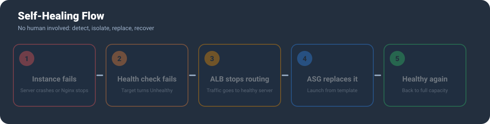
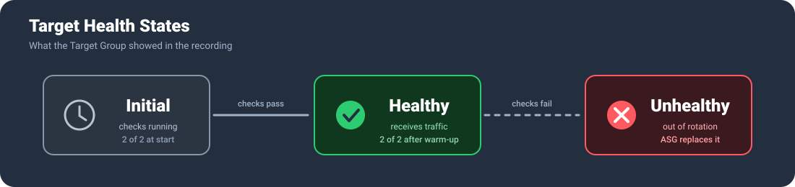
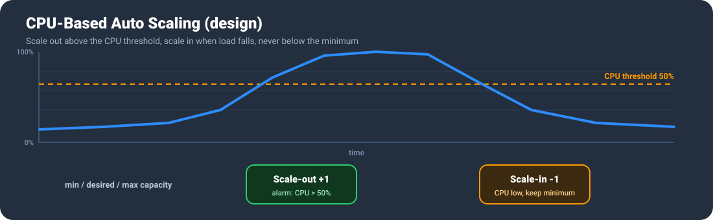

<div align="center">



<br/>


-232F3E?style=for-the-badge)


**A web application that survives server failures, spreads traffic across two Availability Zones and recovers on its own.**

[Overview](#-overview) · [Architecture](#-architecture) · [Self-Healing](#-self-healing-flow) · [Output](#-implementation-output) · [Setup](#-how-to-build-it) · [Future Scope](#-future-scope)

</div>

---

## 📌 Overview

Traditional hosting depends on one server and a human watching it. When that server fails, the site goes down until someone notices. When traffic spikes, the server is too small. When traffic is low, you still pay for capacity you do not use.

This project removes those problems with **self-healing, elastic infrastructure on AWS**:

- Two **Ubuntu EC2** instances run **Nginx** in **different Availability Zones**.
- An **Application Load Balancer (ALB)** is the only public entry point and spreads requests across them.
- A **Target Group** runs health checks and sends traffic **only to healthy servers**.
- An **Auto Scaling Group** keeps the desired number of servers running, replaces failed ones and scales with CPU load.
- **CloudWatch** watches the metrics and raises the scaling alarms.
- **S3** stores static files and backups, and an **IAM Role** gives EC2 access to it without storing any access keys.


---

## ✨ Key Features

| | Feature | What it gives you |
|---|---|---|
| 🌐 | **Single entry point** | Users open one ALB DNS name, no matter how many servers exist behind it |
| ⚖️ | **Load balancing** | Requests are shared between WebServer-1 and WebServer-2 |
| 🏢 | **Multi-AZ design** | Servers run in `us-east-2a` and `us-east-2b`, so one zone failing does not take the site down |
| ❤️‍🩹 | **Self-healing** | Unhealthy instances are removed from rotation and replaced automatically |
| 📈 | **CPU-based scaling** | Scale out under load, scale in when load drops, within min / desired / max limits |
| 🧱 | **Repeatable setup** | A Launch Template with User Data builds every new server identically |
| 🔐 | **Secure by design** | EC2 accepts HTTP only from the ALB Security Group; IAM Role instead of access keys |

---

## 🏗 Architecture



**How a request travels**

1. The user sends an HTTP request to the **ALB DNS name** on port 80.
2. The ALB **listener** receives it and forwards it to the **Target Group**.
3. The Target Group picks a **healthy** EC2 instance (round-robin) in one of the two Availability Zones.
4. **Nginx** on that instance returns the page, which shows the server name and its Availability Zone.
5. Meanwhile **CloudWatch** collects CPU and health metrics, and the **Auto Scaling Group** acts on the alarms.

### Components

| Component | Role in the system |
|---|---|
| **Users / Internet** | Clients that send HTTP requests to the application through the ALB DNS name |
| **Application Load Balancer** | Public entry point (Layer 7). The listener on port 80 forwards requests to healthy targets |
| **Target Group** | Pool of registered EC2 instances. Runs health checks and routes only to healthy ones |
| **EC2 + Nginx (Ubuntu)** | Application servers in different Availability Zones that serve the website |
| **Launch Template** | Blueprint (AMI, instance type, IAM Role, Security Group, User Data) used to create instances |
| **Auto Scaling Group** | Keeps min / desired / max capacity, replaces unhealthy instances, applies the scaling policy |
| **Amazon CloudWatch** | Collects CPU and health metrics and raises alarms for scale-out and scale-in |
| **Amazon S3** | Private bucket for static assets and backups |
| **IAM Role** | Gives EC2 temporary permissions to S3, so no keys are stored on servers |
| **VPC, Subnets, Security Groups** | Public subnets in two AZs. EC2 allows HTTP only from the ALB Security Group |

---

## ❤️‍🩹 Self-Healing Flow

When a server dies, nobody has to log in. The platform detects the failure, stops sending traffic to it and brings up a replacement.



> The animation highlights each stage in turn: **fail → detect → isolate → replace → recover**. Visitors keep getting answers from the healthy server the whole time.

### Target health states



A target is always in one of these states in the Target Group. A new target starts as **Initial** while the load balancer runs its first checks, becomes **Healthy** when it passes and starts receiving traffic, and becomes **Unhealthy** if checks fail, at which point it stops receiving traffic and the Auto Scaling Group replaces it.

---

## 📈 Auto Scaling



CloudWatch watches the average CPU of the group. When it stays above the threshold (50% in this design), an alarm tells the Auto Scaling Group to **add** an instance from the Launch Template. When load falls, the extra instance is **removed**, but the group never drops below its minimum. This keeps the site fast at peak time and the bill low at quiet time.

> ℹ️ The recorded demo below covers the load balancer, target group and the two web servers. The scaling policy and CloudWatch alarms are part of the design described here.

---

## 📸 Implementation Output

All screenshots are from the working deployment in the AWS Console (**US East (Ohio), us-east-2**). The deployment has **WebServer-1** in `us-east-2a` and **WebServer-2** in `us-east-2b`, registered in the target group **HA-Project-TG** behind the load balancer **HA-Project-ALB**. The account name and ID have been blurred.

### 1️⃣ Target Group registration and health checks

<p align="center"></p>

**Targets registered, status Initial.** The target group `HA-Project-TG` lists two targets on port 80: `i-0cd003dc03185963b` (WebServer-2, `us-east-2b`) and `i-0b6beb49b30eb8faf` (WebServer-1, `us-east-2a`). *Initial* means the load balancer has just registered them and is still running the first health checks. No traffic is sent until they pass.

<p align="center"></p>

**Target group summary.** Total targets 2, Healthy 0, Unhealthy 0, Initial 2. The group is attached to the load balancer `HA-Project-ALB`. This is the starting state before the checks complete.

<p align="center"></p>

**Both targets Healthy.** After a few check cycles both instances turn **Healthy** (green tick). This proves Nginx on each server answers the health check on port 80, and that the two servers sit in two different Availability Zones, so there is no single point of failure. The load balancer now sends traffic to both.

### 2️⃣ Application Load Balancer

<p align="center"></p>

**Provisioning.** `HA-Project-ALB` is an *application* load balancer, *internet-facing*, using IPv4. AWS is still creating its nodes in the chosen subnets.

<p align="center"></p>

**Active.** Once provisioning finishes, the state changes to **Active**. Only an active load balancer can accept and forward requests.

<p align="center"></p>

**Load balancer details.** Type Application, scheme Internet-facing, status Active, IPv4, VPC `vpc-06042964314e9d02f`, created on 5 September 2026. It spans two Availability Zones, `us-east-2a` (use2-az1) and `us-east-2b` (use2-az2), each with its own subnet. Spreading the ALB over two zones is what lets the system survive the loss of a whole zone. Its **DNS name** (`HA-Project-ALB-1410117085.us-east-2.elb.amazonaws.com`) is the public address of the application.

<p align="center"></p>

**DNS name and listener.** The DNS name is copied so it can be pasted into a browser. The *Listeners and rules* tab shows one listener that accepts HTTP and forwards to the target group `HA-Project-TG`.

### 3️⃣ The web application through the load balancer

<p align="center"></p>

**Response from Server 1.** Opening the ALB DNS name in the browser (marked "Not secure" because the demo uses plain HTTP) returns **"Hello from Server 1 - AZ-A"** from `WebServer-1` in `us-east-2a`, status *Healthy and Running*. The URL is the load balancer, not an individual server.

<p align="center"></p>

**Response from Server 2.** Refreshing the same URL returns **"Hello from Server 2 - AZ-B"** from `WebServer-2` in `us-east-2b`. The page colour also changes (blue for Server 1, orange for Server 2), so the switch between servers is easy to see.

---

## ✅ Results

Refreshing the same ALB URL again and again made the answer **alternate between Server 1 (AZ-A) and Server 2 (AZ-B)**. This shows:

- **Load balancing:** requests are shared across both servers.
- **High availability:** the servers live in two Availability Zones.
- **Health checking:** only Healthy targets receive traffic, and a failed one is removed from rotation.
- **One stable address:** users never need to know how many servers exist or which one answered.

---

## 🛠 How to Build It

A condensed walkthrough in the AWS Console (region **us-east-2**).

<details>
<summary><b>Click to expand the step-by-step guide</b></summary>

### 1. Security Groups
- `alb-sg`: allow **HTTP 80** from `0.0.0.0/0`.
- `web-sg`: allow **HTTP 80 only from `alb-sg`** (security group chaining), plus SSH 22 from your IP if you need it.

### 2. Launch Template
- AMI: **Ubuntu Server 22.04 LTS**, type `t2.micro` / `t3.micro`, security group `web-sg`.
- Attach an **IAM Role** with S3 access if the app needs the bucket.
- Paste this into **User Data** (it installs Nginx and shows the server name and AZ):

```bash
#!/bin/bash
apt-get update -y
apt-get install -y nginx
TOKEN=$(curl -s -X PUT "http://169.254.169.254/latest/api/token" -H "X-aws-ec2-metadata-token-ttl-seconds: 21600")
AZ=$(curl -s -H "X-aws-ec2-metadata-token: $TOKEN" http://169.254.169.254/latest/meta-data/placement/availability-zone)
HOST=$(hostname)
cat > /var/www/html/index.html <<HTML
<!DOCTYPE html>
<html><head><title>HA Project</title>
<style>body{font-family:Arial;background:#eaf2fb;text-align:center;padding-top:80px}
.card{display:inline-block;background:#1a66c0;color:#fff;padding:40px 60px;border-radius:14px}</style></head>
<body><div class="card"><h1>Hello from $HOST</h1>
<p><b>Availability Zone:</b> $AZ</p><p><b>Status:</b> Healthy and Running</p></div></body></html>
HTML
systemctl enable --now nginx
```

### 3. Target Group
- Type **Instances**, protocol **HTTP : 80**, health check path `/`.
- Name it `HA-Project-TG` and register the instances.

### 4. Application Load Balancer
- Scheme **Internet-facing**, IPv4, select the VPC and **two subnets in different AZs**.
- Security group `alb-sg`, listener **HTTP : 80 → HA-Project-TG**.

### 5. Auto Scaling Group
- Use the Launch Template, the same two subnets, and attach to `HA-Project-TG`.
- Turn on **ELB health checks** so unhealthy instances are replaced.
- Set min / desired / max capacity and a **CPU target-tracking** policy (for example 50%).

### 6. Test
- Open the **ALB DNS name** in a browser and refresh. The page should alternate between the servers.
- To test self-healing, stop one instance and watch the Target Group mark it Unhealthy and the Auto Scaling Group launch a replacement.

### 7. Clean up (avoid charges)
Delete the Auto Scaling Group, the load balancer, the target group and any leftover EC2 instances.

</details>

---

## ⚖️ Advantages and Limitations

| 👍 Advantages | ⚠️ Limitations |
|---|---|
| No single point of failure | Scaling is not instant (boot time and cooldown) |
| Self-healing with no manual work | ALB and extra instances cost money if left running |
| Scales out for load and in to save cost | Instances must be stateless (data belongs in S3 / RDS / EFS) |
| Better performance through load distribution | A CPU-only policy may not fit every workload |
| Consistent, automated, repeatable deployments | Demo uses HTTP only (no HTTPS or custom domain) |
| Secure Security Group chaining and IAM Role | Needs careful threshold tuning and AWS knowledge |

---

## 🚀 Future Scope

- 🔒 Enable **HTTPS** with AWS Certificate Manager and a custom domain on Route 53
- 🗄 Add a database such as **Amazon RDS / Aurora Multi-AZ** for stateful apps
- 🛡 Use private subnets with NAT, plus **CloudFront** and **AWS WAF**
- 📊 Use target-tracking on request count and add **SNS** email alerts
- 🤖 Automate everything with **Terraform / CloudFormation** and a CI/CD pipeline

---

## 🏁 Conclusion

Combining **EC2, an Application Load Balancer, Auto Scaling and CloudWatch** produces infrastructure that heals itself and adapts to demand without manual effort. The captured output confirms that two web servers in different Availability Zones registered in a target group, passed their health checks and served the application alternately through a single load balancer address. Failed instances are replaced, traffic is shared across healthy servers, and capacity follows load, which gives **high availability, good performance and lower cost**.

---

## 👤 Author

**Gunda Tejeswara Rao** · CSE-IoT · Cloud Infrastructure domain

<br/>


